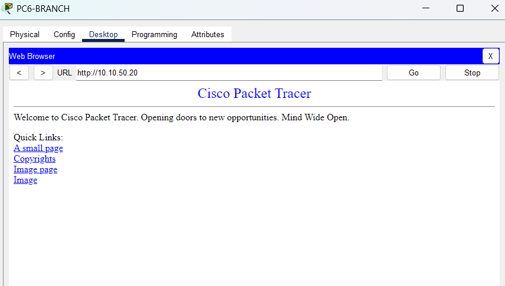

# Day 4 — Web Server Configuration

## Overview

On Day 4, I configured and tested the web server in my Secure University Campus Network project using Cisco Packet Tracer.

The objective was to host a website on the main campus and verify that devices on both the main and branch campuses could access it.

## Objectives

- Configure the web server.
- Enable the HTTP service.
- Test website access from the main campus.
- Test website access from the branch campus.
- Verify communication between client devices and the web server.

## Network Details

| Setting | Value |
|---|---|
| Web Server | SERVER2-WEB |
| IP Address | `10.10.50.20` |
| Subnet Mask | `255.255.255.0` |
| Default Gateway | `10.10.50.1` |
| Server VLAN | VLAN 50 — SERVERS |
| Web Protocol Tested | HTTP |
| Website URL | `http://10.10.50.20` |

## Web Server Configuration

The web server was configured with a static IPv4 address in the main-campus server network.

The HTTP service was enabled through the Services tab on SERVER2-WEB.

The default Cisco Packet Tracer webpage was used to verify that the web server could serve web content.

## Configuration Steps

1. Opened SERVER2-WEB in Cisco Packet Tracer.
2. Checked the server's IP address and default gateway.
3. Opened the Services tab.
4. Selected HTTP.
5. Confirmed that HTTP was switched ON.
6. Opened the web browser on PC1-ADMIN.
7. Entered `http://10.10.50.20` and verified that the webpage loaded.
8. Repeated the test from PC6-BRANCH.

## Testing and Results

| Test | Source Device | Destination | Result |
|---|---|---|:---:|
| Main-campus web access | PC1-ADMIN | SERVER2-WEB (`10.10.50.20`) | PASS |
| Branch-campus web access | PC6-BRANCH | SERVER2-WEB (`10.10.50.20`) | PASS |

Both tests successfully displayed the default Cisco Packet Tracer welcome page.

## Screenshots

### 1. Main-Campus Web Server Test

This screenshot demonstrates that PC1-ADMIN can access the web server using HTTP.

### 2. Branch-Campus Web Server Test

This screenshot demonstrates that PC6-BRANCH can access the main-campus web server.

## What I Learned

- How to enable the HTTP service on a Packet Tracer server.
- How to access a website using its IPv4 address.
- How inter-VLAN routing allows clients to access a server in another VLAN.
- How static routing enables clients at a branch campus to reach a server at the main campus.
- How to verify web connectivity through practical testing.

## Day 4 Status

**Status: Completed**

The HTTP service was enabled, and website access was successfully verified from both the main campus and the branch campus.

## Next Steps

- Configure SSH for secure remote device management.
- Configure switch port security.
- Implement and test Access Control Lists (ACLs).
- Continue testing and documenting the network.
