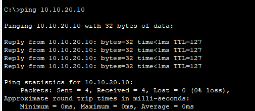
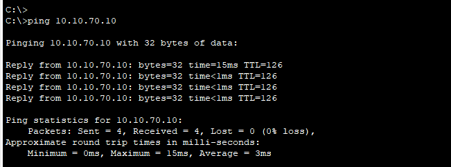
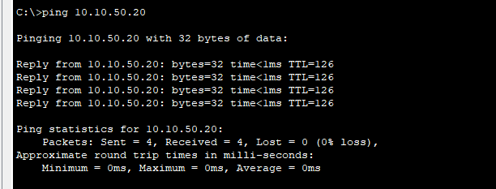
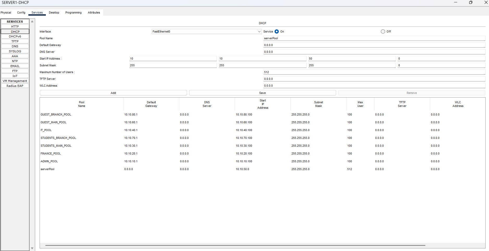
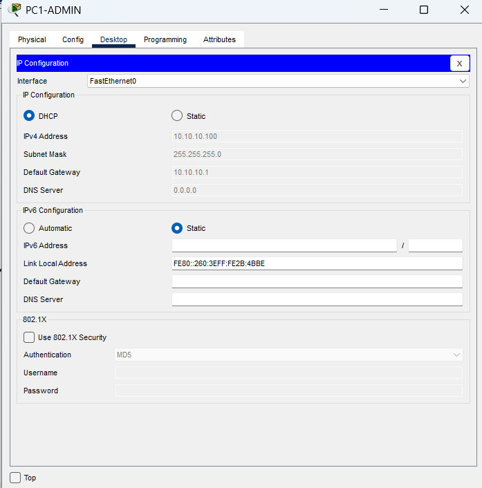
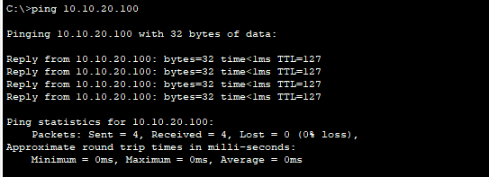
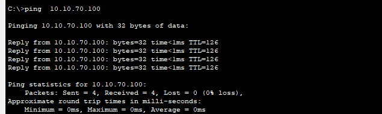
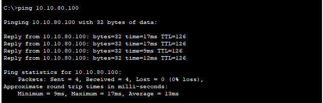

# Secure University Campus Network

A simulated university campus network built using Cisco Packet Tracer to gain hands-on experience with enterprise networking concepts. The project represents a main campus and a branch campus, with a focus on network segmentation, connectivity, and security.

## Network Topology

The diagram below illustrates the planned network design for the main and branch campuses, including the proposed VLAN structure.

*Note: IP addressing, inter-VLAN routing, DHCP, campus routing, and security configurations will be implemented and tested in upcoming stages.*

## Project Objectives

Design and implement a university campus network using Cisco Packet Tracer.

Separate departments using VLANs.

Configure trunk links and router-on-a-stick inter-VLAN routing.

Implement IPv4 addressing and subnetting.

Connect the main and branch campuses using static routing.

Configure network services such as DHCP and a web server.

Improve network security using SSH, switch port security, and Access Control Lists (ACLs).

Test connectivity and document the implementation.

## Technology Stack

Cisco Packet Tracer

IPv4 Addressing and Subnetting

VLANs and Trunking

Router-on-a-Stick Inter-VLAN Routing

Static Routing

DHCP (planned)

Web Server Configuration (planned)

SSH (planned)

Switch Port Security (planned)

Wireless LAN (WLAN)

Access Control Lists (ACLs) (planned)

## Network Design

The network contains two locations:

Main Campus: ADMIN, FINANCE, STUDENTS, IT, SERVERS, and GUEST_WIFI VLANs.

Branch Campus: STUDENTS and GUEST_WIFI VLANs, using separate IP subnets from the main campus.

The routers are connected through a point-to-point Ethernet link using the 10.10.254.0/30 network. Static routes allow the two campuses to communicate.

## VLAN and IP Addressing Plan

### Main Campus

| VLAN ID | VLAN Name | Network Address | Default Gateway |
|:---:|---|---|---|
| 10 | ADMIN | `10.10.10.0/24` | `10.10.10.1` |
| 20 | FINANCE | `10.10.20.0/24` | `10.10.20.1` |
| 30 | STUDENTS | `10.10.30.0/24` | `10.10.30.1` |
| 40 | IT | `10.10.40.0/24` | `10.10.40.1` |
| 50 | SERVERS | `10.10.50.0/24` | `10.10.50.1` |
| 60 | GUEST_WIFI | `10.10.60.0/24` | `10.10.60.1` |

### Branch Campus

| VLAN ID | VLAN Name | Network Address | Default Gateway |
|:---:|---|---|---|
| 30 | STUDENTS | `10.10.70.0/24` | `10.10.70.1` |
| 60 | GUEST_WIFI | `10.10.80.0/24` | `10.10.80.1` |

### Router-to-Router Link

| Router | Interface | IP Address | Subnet Mask |
|---|---|---|---|
| R1-MAIN | GigabitEthernet0/1 | `10.10.254.1` | `255.255.255.252` |
| R2-BRANCH | GigabitEthernet0/1 | `10.10.254.2` | `255.255.255.252` |

## End-Device IP Addressing

| Device | IP Address | Default Gateway |
|---|---|---|
| PC1-ADMIN | `10.10.10.10` | `10.10.10.1` |
| PC2-FINANCE | `10.10.20.10` | `10.10.20.1` |
| PC3-STUDENT | `10.10.30.10` | `10.10.30.1` |
| PC4-STUDENT | `10.10.30.11` | `10.10.30.1` |
| PC5-IT | `10.10.40.10` | `10.10.40.1` |
| PC6-BRANCH | `10.10.70.10` | `10.10.70.1` |
| SERVER1-DHCP | `10.10.50.10` | `10.10.50.1` |
| SERVER2-WEB | `10.10.50.20` | `10.10.50.1` |
| AP1-MAIN | `10.10.60.2` | `10.10.60.1` |
| LAPTOP1-GUEST | `10.10.60.10` | `10.10.60.1` |
| AP2-BRANCH | `10.10.80.2` | `10.10.80.1` |
| LAPTOP2-STAFF | `10.10.80.10` | `10.10.80.1` |

## Day 1 — Topology Design and VLAN Configuration

### Completed Tasks

- Designed the initial main-campus and branch-campus topology.
- Added and named routers, switches, PCs, servers, access points, and laptops.
- Connected the network devices.
- Created the main-campus VLAN plan.
- Created VLANs on the switches.
- Configured relevant access ports and trunk links.
- Prepared the network for IP addressing and routing.

### VLAN Configuration

- VLAN 10 — ADMIN
- VLAN 20 — FINANCE
- VLAN 30 — STUDENTS
- VLAN 40 — IT
- VLAN 50 — SERVERS
- VLAN 60 — GUEST_WIFI

## Day 2 — IP Addressing and Routing

### Completed Tasks

- Configured IPv4 addresses and default gateways for end devices.
- Configured the point-to-point link between R1-MAIN and R2-BRANCH.
- Configured router subinterfaces for inter-VLAN routing.
- Configured static routes between the main and branch campuses.
- Verified default gateway connectivity for the tested devices.
- Tested inter-VLAN communication.
- Tested communication between the main and branch campuses.
- Verified branch-campus connectivity to the main-campus server IP address.
- Tested wireless connectivity across the campuses.

### Connectivity Test Results

The following ping tests completed successfully with four replies and `0%` packet loss.

| Test | Source | Destination | Result |
|---|---|---|:---:|
| Inter-VLAN routing | PC1-ADMIN | PC2-FINANCE | PASS |
| Main-to-branch connectivity | PC1-ADMIN | PC6-BRANCH | PASS |
| Branch-to-server connectivity | PC6-BRANCH | SERVER2-WEB | PASS |
| Wireless cross-campus connectivity | LAPTOP1-GUEST | LAPTOP2-STAFF | PASS |

## Connectivity Test Screenshots

Upload the screenshots to the Day-02-IP-Addressing-and-Routing/ folder to display them here.

Inter-VLAN Routing Test
This test verifies communication between devices in different VLANs

Main-to-Branch Connectivity
This test verifies communication between the main campus and the branch campus.

Branch-to-Server Connectivity
This test verifies that a device in the branch campus can communicate with the main-campus server.

## Day 3 — DHCP Configuration
### Objectives
- Configure the DHCP service on `SERVER1-DHCP`.
- Create separate DHCP pools for the required networks.
- Configure DHCP relay on the routers using `ip helper-address`.
- Obtain IP addresses automatically on client devices.
- Verify DHCP assignments and connectivity.

### DHCP Server Configuration
The DHCP service was enabled on `SERVER1-DHCP` with the static IP address `10.10.50.10/24` and default gateway `10.10.50.1`. Seven DHCP pools were created to provide addresses to clients in the main and branch campuses:

| DHCP Pool Name | Network | Default Gateway | Starting IP |
| :--- | :--- | :--- | :--- |
| `ADMIN_POOL` | 10.10.10.0/24 | 10.10.10.1 | 10.10.10.100 |
| `FINANCE_POOL` | 10.10.20.0/24 | 10.10.20.1 | 10.10.20.100 |
| `STUDENTS_MAIN_POOL` | 10.10.30.0/24 | 10.10.30.1 | 10.10.30.100 |
| `IT_POOL` | 10.10.40.0/24 | 10.10.40.1 | 10.10.40.100 |
| `GUEST_MAIN_POOL` | 10.10.60.0/24 | 10.10.60.1 | 10.10.60.100 |
| `STUDENTS_BRANCH_POOL` | 10.10.70.0/24 | 10.10.70.1 | 10.10.70.100 |
| `GUEST_BRANCH_POOL` | 10.10.80.0/24 | 10.10.80.1 | 10.10.80.100 |

*Each pool uses subnet mask `255.255.255.0`.*

### DHCP Relay Configuration
The `ip helper-address 10.10.50.10` command was configured on router subinterfaces:
- **R1-MAIN:** VLANs 10, 20, 30, 40, and 60.
- **R2-BRANCH:** VLANs 30 and 60.

### DHCP Verification Sample
| Client Device | Assigned DHCP Address | Default Gateway |
| :--- | :--- | :--- |
| PC1-ADMIN | 10.10.10.100 | 10.10.10.1 |
| PC6-BRANCH | 10.10.70.100 | 10.10.70.1 |

The other client devices were also switched to DHCP and successfully obtained their IP addresses. Servers and access points retain their static IP addresses.

# Connectivity Test Results After DHCP
| Test Source | Test Destination | Result |
| :--- | :--- | :--- |
| Inter-VLAN connectivity (PC1-ADMIN) | PC2-FINANCE | PASS |
| Main-to-branch connectivity (PC1-ADMIN) | PC6-BRANCH | PASS |
| Wireless cross-campus connectivity (LAPTOP1-GUEST) | LAPTOP2-STAFF | PASS |

All three final ping tests completed successfully with four replies and 0% packet loss.

## Day 3 Screenshots
Upload the screenshots to the `Day-03-DHCP-Configuration/` folder using the filenames below:

11. **DHCP Pool Configuration:**
   

2. **DHCP Client IP Configuration:**
   

3. **Inter-VLAN Connectivity:**
   

4. **Inter-Campus Connectivity:**
   

5. **Wireless Connectivity:**
   
   
## Repository Structure

secure-campus-network/
├── README.md
├── Day-01-Topology-Design/
│   ├── requirements.md
│   ├── vlan-plan.md
│   └── campus-topology.png
├── Day-02-IP-Addressing-and-Routing/
│   ├── ip-addressing-plan.md
│   ├── static-routing.md
│   ├── inter-vlan-routing-test.png
│   ├── main-to-branch-connectivity.png
│   └── branch-to-server-connectivity.png
├── Day-03-DHCP-Configuration/
│   ├── Day-03-DHCP-Configuration.md
│   ├── DHCP-Client-IP.png
│   ├── DHCP-Pools.png
│   ├── Inter-Campus-Ping.png
│   ├── Inter-VLAN-Ping.png
│   └── Wireless-Ping.png

## Remaining Tasks

Configure and test the web service on SERVER2-WEB.

Configure SSH for secure remote device management.

Implement switch port security.

Configure and test Access Control Lists (ACLs).

Perform additional connectivity and security tests.

Complete the configuration documentation and final project verification.

## Project Goals

Develop practical Cisco networking and troubleshooting skills.

Understand how VLANs, routing, DHCP, and network security work together.

Build a documented networking portfolio for internship applications.

Gain hands-on experience with networking concepts covered in CCNA studies.

## Project Status

Completed: Topology design, VLAN configuration, IPv4 addressing, router-on-a-stick inter-VLAN routing, static routing, DHCP pools, DHCP relay, DHCP client verification, and connectivity testing.

Next Stage: Configure and test the web service, followed by SSH, switch port security, and ACLs.

This project is being developed step by step using Cisco Packet Tracer. Configuration files, documentation, screenshots, and test results will be added as each stage is completed.

