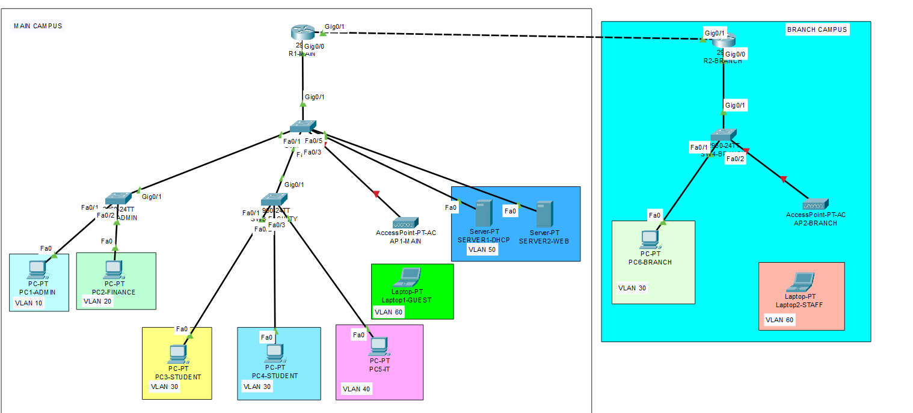

# Secure University Campus Network

A simulated university campus network built using Cisco Packet Tracer to gain hands-on experience with enterprise networking concepts. The project represents a main campus and a branch campus, with a focus on network segmentation, connectivity, and security.

## Network Topology

The diagram below illustrates the planned network design for the main and branch campuses, including the proposed VLAN structure.

*Note: IP addressing, inter-VLAN routing, DHCP, campus routing, and security configurations will be implemented and tested in upcoming stages.*

## Project Objectives

Design and implement a university campus network using Cisco Packet Tracer.

Separate departments using VLANs.

Configure trunk links and router-on-a-stick inter-VLAN routing.

Implement IPv4 addressing and subnetting.

Connect the main and branch campuses using static routing.

Configure network services such as DHCP and a web server.

Improve network security using SSH, switch port security, and Access Control Lists (ACLs).

Test connectivity and document the implementation.

## Technology Stack

Cisco Packet Tracer

IPv4 Addressing and Subnetting

VLANs and Trunking

Router-on-a-Stick Inter-VLAN Routing

Static Routing

DHCP (planned)

Web Server Configuration (planned)

SSH (planned)

Switch Port Security (planned)

Wireless LAN (WLAN)

Access Control Lists (ACLs) (planned)

## Network Design

The network contains two locations:

Main Campus: ADMIN, FINANCE, STUDENTS, IT, SERVERS, and GUEST_WIFI VLANs.

Branch Campus: STUDENTS and GUEST_WIFI VLANs, using separate IP subnets from the main campus.

The routers are connected through a point-to-point Ethernet link using the 10.10.254.0/30 network. Static routes allow the two campuses to communicate.

## VLAN and IP Addressing Plan

# Main Campus

VLAN ID

VLAN Name

Network Address

Default Gateway

10

ADMIN

10.10.10.0/24

10.10.10.1

20

FINANCE

10.10.20.0/24

10.10.20.1

30

STUDENTS

10.10.30.0/24

10.10.30.1

40

IT

10.10.40.0/24

10.10.40.1

50

SERVERS

10.10.50.0/24

10.10.50.1

60

GUEST_WIFI

10.10.60.0/24

10.10.60.1

# Branch Campus

VLAN ID

VLAN Name

Network Address

Default Gateway

30

STUDENTS

10.10.70.0/24

10.10.70.1

60

GUEST_WIFI

10.10.80.0/24

10.10.80.1

# Router-to-Router Link

Router

Interface

IP Address

Subnet Mask

R1-MAIN

GigabitEthernet0/1

10.10.254.1

255.255.255.252

R2-BRANCH

GigabitEthernet0/1

10.10.254.2

255.255.255.252

# End-Device IP Addressing

Device

IP Address

Default Gateway

PC1-ADMIN

10.10.10.10

10.10.10.1

PC2-FINANCE

10.10.20.10

10.10.20.1

PC3-STUDENT

10.10.30.10

10.10.30.1

PC4-STUDENT

10.10.30.11

10.10.30.1

PC5-IT

10.10.40.10

10.10.40.1

PC6-BRANCH

10.10.70.10

10.10.70.1

SERVER1-DHCP

10.10.50.10

10.10.50.1

SERVER2-WEB

10.10.50.20

10.10.50.1

AP1-MAIN

10.10.60.2

10.10.60.1

LAPTOP1-GUEST

10.10.60.10

10.10.60.1

AP2-BRANCH

10.10.80.2

10.10.80.1

LAPTOP2-STAFF

10.10.80.10

10.10.80.1

Note: Update this table if the actual Packet Tracer configuration changes.

## Day 1 — Topology Design and VLAN Configuration

# Completed Tasks

Designed the initial main-campus and branch-campus topology.

Added and named routers, switches, PCs, servers, access points, and laptops.

Connected the network devices.

Created the main-campus VLAN plan.

Created VLANs on the switches.

Configured relevant access ports and trunk links.

Prepared the network for IP addressing and routing.

# VLAN Configuration

VLAN 10 — ADMIN

VLAN 20 — FINANCE

VLAN 30 — STUDENTS

VLAN 40 — IT

VLAN 50 — SERVERS

VLAN 60 — GUEST_WIFI

## Day 2 — IP Addressing and Routing

# Completed Tasks

Configured IPv4 addresses and default gateways for end devices.

Configured the point-to-point link between R1-MAIN and R2-BRANCH.

Configured router subinterfaces for inter-VLAN routing.

Configured static routes between the main and branch campuses.

Verified default gateway connectivity for the tested devices.

Tested inter-VLAN communication.

Tested communication between the main and branch campuses.

Verified branch-campus connectivity to the main-campus web server IP address.

Tested wireless connectivity across the campuses.

## Connectivity Test Results

The following ping tests completed successfully with four replies and 0% packet loss.

Test

Source

Destination

Result

Inter-VLAN routing

PC1-ADMIN

PC2-FINANCE

PASS

Main-to-branch connectivity

PC1-ADMIN

PC6-BRANCH

PASS

Branch-to-server connectivity

PC6-BRANCH

SERVER2-WEB

PASS

Wireless cross-campus connectivity

LAPTOP1-GUEST

LAPTOP2-STAFF

PASS

These tests verify the listed communication paths. They do not mean that every possible network path or security policy has been tested.

## Connectivity Test Screenshots

Upload the screenshots to the Day-02-IP-Addressing-and-Routing/ folder to display them here.

Inter-VLAN Routing Test
This test verifies communication between devices in different VLANs
Day-02-IP-Addressing-and-Routing/inter-vlan-routing-test.png

Main-to-Branch Connectivity
This test verifies communication between the main campus and the branch campus.
Day-02-IP-Addressing-and-Routing/main-to-branch-connectivity.png

Branch-to-Server Connectivity
This test verifies that a device in the branch campus can communicate with the main-campus server.
Day-02-IP-Addressing-and-Routing/branch-to-server-connectivity.png

Note: Ensure the screenshot filenames and folder paths match the files uploaded to GitHub.

## Repository Structure

secure-campus-network/
├── README.md
├── Day-01-Topology-Design/
│   ├── requirements.md
│   ├── vlan-plan.md
│   └── campus-topology.png.png
├── Day-02-IP-Addressing-and-Routing/
│   ├── ip-addressing-plan.md
│   ├── static-routing.md
│   ├── inter-vlan-routing-test.png
│   ├── main-to-branch-connectivity.png
│   └── branch-to-server-connectivity.png
└── packet-tracer/
    └── Secure-University-Campus-Network.pkt

Note: This represents the intended project structure. Upload the files and ensure their filenames match before relying on these paths.

## Remaining Tasks

Configure and test the DHCP service.

Configure and test the web service.

Configure SSH for secure remote device management.

Implement switch port security.

Configure and test Access Control Lists (ACLs).

Perform additional connectivity and security tests.

Document the completed configurations and test results.

## Project Goals

Develop practical Cisco networking and troubleshooting skills.

Understand how VLANs, routing, DHCP, and network security work together.

Build a documented networking portfolio for internship applications.

Gain hands-on experience with networking concepts covered in CCNA studies.

## Project Status

Completed: Initial topology design, VLAN configuration, IP addressing, router-on-a-stick inter-VLAN routing, static routing, and the documented connectivity tests.

Next Stage: Configure and test DHCP services.

This project is being developed step by step using Cisco Packet Tracer. Configuration files, documentation, screenshots, and test results will be added as each stage is completed.
